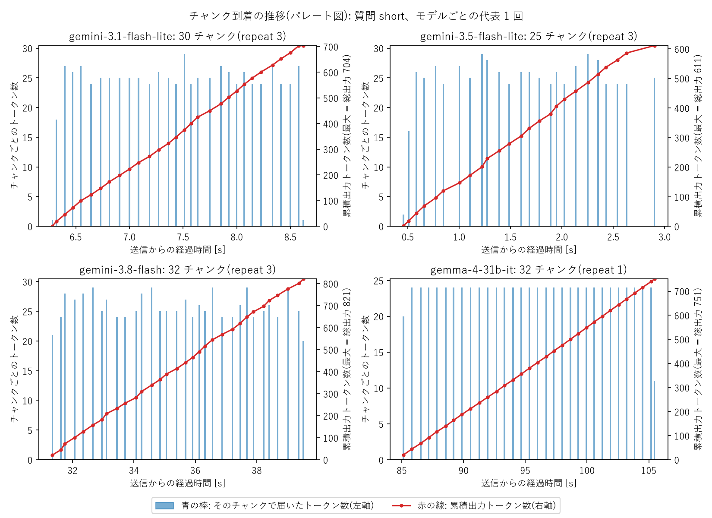
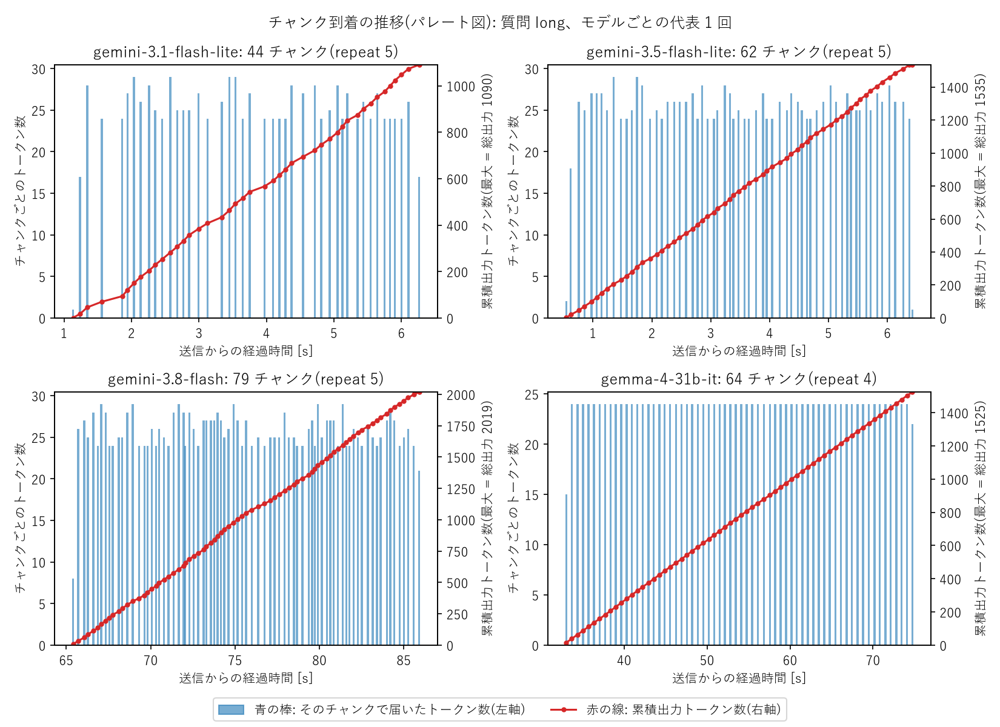
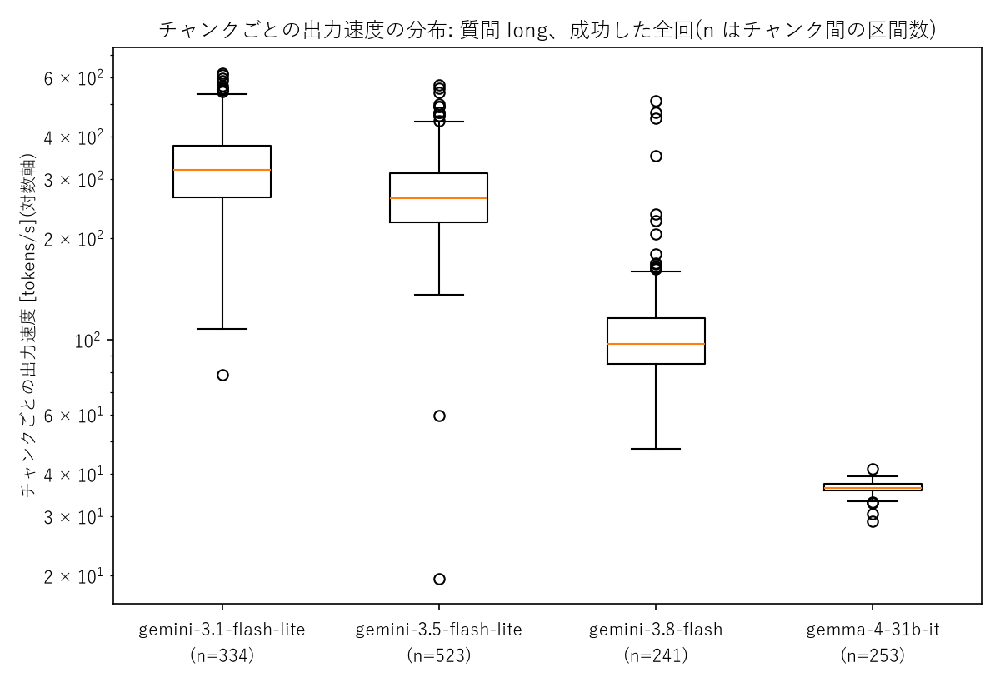

# 第1回 解答

## 演習

> ※ 基礎レベルの内容も含みます

- 講座に固有の質問(宿題の3レベル)へのモデルの回答(要約でよい):
  - `gemini-3.5-flash-lite` は「3レベル」を、基礎・入門/応用・実践/発展・挑戦という一般的な難易度の3段階であると説明した。「資料に具体的な定義があればそちらが優先」とは書いてあったが、講座の実際の内容は知らないまま、もっともらしく答えていた。
- 用語集の正しい意味と比べて気づいたこと:
  正しくは「基礎(講義内容の確認)／実装(自分でコードを書く)／発展(調査や試行)」で、どれか1つに取り組めば完了、原則として採点しない。加えて、1つ行えば完了であるという事実も書いてこなかった。
- 表示できたトークン数(入力 / 出力):21 / 401

## 宿題

- 取り組んだレベル:**発展**(応答時間とトークン数を計測し、複数のモデルと質問で比較する。無料枠のレート制限との関係を考察する)
- やったこと:

### 実験条件

以下の4モデルについて3種類の質問を用意して、応答の内容や時間・速度の計測を行った。

| 項目 | 内容 |
|---|---|
| モデル | `gemini-3.5-flash-lite`、`gemini-3.1-flash-lite`、`gemini-3.8-flash`、`gemma-4-31b-it` |
| 質問 | `short`:「LoRAとは何ですか？」 |
| | `false_premise`:「秋田大学の学生に伝わっている、ヒグマに関するジンクスはなんですか？」 |
| | `long`: 「LoRAの仕組みについて解説する記事を、全体像から、低ランク分解の考え方など技術的側面を踏まえ、この手法のメリットやデメリット、実際の活用例について整理し、詳しく説明してください。聴衆は専門外の大学1年生が理解できる程度の言葉で読みやすい記事を心がけてください。」 |
| 呼び出し | `generate_content_stream`(ストリーミング)。temperatureなどはデフォルトの値を用いた |

> 補足
> 
> - `false_premise` はローカルな話題として選出した。実在するのはカモシカに関するジンクスであり、ヒグマに関するジンクスは特に伝わっていない
>  - ちなみに、正しくは「学内でカモシカに奇数回遭遇すると留年する」というジンクスが伝わっている
> - 無料枠を使用するレート制限を避けるために、質問ごとの間隔は `60 / RPM + 1` 秒以上空けた
> - どのモデルについても外部ツールの利用(Google検索によるグラウンディング)は無効とした

以下の値をについて計測を行った。

- `latency_s`:送信から最後のチャンクを受信するまでの時間 (thinking を含む)
- `ttft_s`:送信から最初のチャンクを受信するまでの時間 (TTFT)
- `output_s`:`latency_s − ttft_s`、最初の出力からの所要時間
- `prompt_tokens` / `output_tokens` / `thinking_tokens`:APIの `usage_metadata` の値をそのまま取得
- `chunks`:回答テキストを含むチャンクごとの `[受信時刻, 文字数, 累積出力トークン数]` の組

これを元に、リクエストごとの出力速度を `output_tokens / output_s` で求めた。

成果物:

| ファイル | 内容 |
|---|---|
| `lectures/01/src/measure_llm.py` | 計測と集計のスクリプト |
| `lectures/01/src/test_measure_llm.py` | 集計部分のテスト(API 不要) |
| `lectures/01/results/measurements.jsonl` | 最初の 35 回の生データ(回答本文とチャンクごとの時刻つき) |
| `lectures/01/results/measurements_long.jsonl` | `long` の追加計測 20 回の生データ |
| `lectures/01/results/excluded.jsonl` | 集計から外した 1 回(gemini-3.8-flash の `long`) |
| `lectures/01/results/summary.md` | 上の 2 つを合算した集計表(モデル別、モデル×質問別) |
| `lectures/01/src/plot_chunks.py`、`lectures/01/results/chunk_*.png` | チャンク到着の推移と出力速度の図 |
| `lectures/01/images/` | AI Studio のレート制限画面のスクリーンショット |
| `app/ask.py` | 演習の改修(入力・出力トークン数を表示) |

### 結果

#### 無料枠のレート制限(AI Studio の画面より)

今回使用したモデルの制限は以下の通りであった。

| モデル | RPM | TPM | RPD |
|---|---|---|---|
| gemini-3.5-flash-lite | 15 | 250K | 500 |
| gemini-3.1-flash-lite | 15 | 250K | 500 |
| gemini-3.8-flash | 5 | 250K | 20 |
| gemma-4-31b-it | 30 | 16K | 14.4K |

#### 応答時間とトークン数

| モデル | 質問 | 試行回数 | 総時間(秒) | TTFT(秒) | 出力トークン | 思考トークン |
|---|---|---|---|---|---|---|
| gemini-3.5-flash-lite | short | 3 | 2.7 | 0.6 | 543 | 0 |
| | false_premise | 3 | 4.0 | 0.5 | 750 | 0 |
| | long | 8 | 7.0 | 0.7 | 1652 | 0 |
| gemini-3.1-flash-lite | short | 2 | 7.5 | 5.2 | 670 | 0 |
| | false_premise | 3 | 6.1 | 4.2 | 497 | 0 |
| | long | 8 | 5.2 | 0.9 | 1064 | 0 |
| gemini-3.8-flash | short | 3 | 39.6 | 31.3 | 824 | 998 |
| | false_premise | 2 | 26.8 | 24.9 | 204 | 1333 |
| | long | 3 | 145.6 | 124.4 | 2063 | 1259 |
| gemma-4-31b-it | short | 1 | 105.5 | 85.1 | 751 | 601 |
| | false_premise | 3 | 51.2 | 38.9 | 405 | 685 |
| | long | 4 | 88.9 | 46.6 | 1512 | 723 |

#### `false_premise` への回答傾向

- `gemini-3.5-flash-lite`
  - すべての回で「秋田県にヒグマはいない」と断りつつ、そのまま存在しないジンクスや学内の逸話を複数出力した
  - [秋田県によれば](https://www.pref.akita.lg.jp/pages/archive/85123)、ヒグマが秋田県には生息しないという話は正しいが、少なくともヒグマに関するジンクスや逸話については事実を確認できなかった
- `gemini-3.8-flash`
  - 全ての回で「学内のヒグマの剥製に乗ると留年する」という存在しない話を答えた
  - 正しくは「学内でカモシカに奇数回遭遇すると留年する」ジンクスである
- `gemini-3.1-flash-lite`
  - 全ての回で「存在しない」と答え、秋田県にはヒグマがいないこと、ツキノワグマとの混同、北海道の大学との混同を理由に挙げた
- `gemma-4-31b-it`
  - 全ての回で「一般には知られていない」と答え、文脈を聞き返す提案を出力した

`gemini-3.1-flash-lite` と `gemma-4-31b-it` は、ジンクスに対して正しい回答を行った。一方、 `gemini-3.8-flash` と `gemini-3.5-flash-lite` には回答の一部にハルシネーションが観察された。

#### レート制限との関係

無料ティアのリクエスト回数には、[Google AI Studio のドキュメント](https://aistudio.google.com/docs/rate-limits)に記載の制限がある。同じ質問を、前の応答を待ちながら、回数/分と RPM の小さいほうの頻度で投げ続けた場合に、RPD を使い切るまでの時間を計算した。回数/分は、質問別の総時間の中央値から求めた(60 ÷ 総時間)。結果を次の表に示す。

| モデル | 質問 | 総時間の中央値(秒) | 回数/分 | RPM | RPD を使い切るまで |
|---|---|---|---|---|---|
| gemini-3.5-flash-lite | `short` | 2.7 | 約 22 | 15 | 約 33 分(RPM が上限) |
| | `false_premise` | 4.0 | 約 15 | 15 | 約 33 分 |
| | `long` | 7.0 | 約 9 | 15 | 約 58 分 |
| gemini-3.1-flash-lite | `short` | 7.5 | 約 8 | 15 | 約 63 分 |
| | `false_premise` | 6.1 | 約 10 | 15 | 約 51 分 |
| | `long` | 5.2 | 約 12 | 15 | 約 43 分 |
| gemini-3.8-flash | `short` | 39.6 | 約 1.5 | 5 | 約 13 分 |
| | `false_premise` | 26.8 | 約 2.2 | 5 | 約 9 分 |
| | `long` | 145.6 | 約 0.4 | 5 | 約 49 分 |
| gemma-4-31b-it | `short` | 105.5 | 約 0.6 | 30 | 使い切れない(1 日約 820 回) |
| | `false_premise` | 51.2 | 約 1.2 | 30 | 使い切れない(1 日約 1,690 回) |
| | `long` | 88.9 | 約 0.7 | 30 | 使い切れない(1 日約 970 回) |

回数/分が RPM を上回ったのは、gemini-3.5-flash-lite の `short` だけだった。応答の短い質問を投げ続ける場合は、逐次実行でも RPM が上限になる可能性がある。

gemma-4-31b-it は RPD が大きく、1 日では使い切れない。応答の遅いモデルでは、制約になるのは RPM ではなく RPD と考えられる。gemini-3.8-flash は、どの質問でも 1 時間以内に RPD の 20 回を使い切る計算だった。

### 気づき・疑問

#### 出力速度のブレ

出力開始から終了までの推移を、以下のパレート図に示す。青の棒は、各チャンクのトークン数(左軸)と受信時刻を表す。赤の線は、累積トークン数(右軸)を表す。右軸の上端は総出力トークン数である。赤の線が上端に達した時点が、出力完了である。図は、各モデルの最後の成功回 1 回分である。

- short の出力タイミングとトークン数の関係

- long の出力タイミングとトークン数の関係

チャンクごとの出力速度は、直前のチャンクとの間のトークン増分を時間間隔で割って求めた。最初のチャンクは、直前の区間がないため箱ひげ図から除いた。間隔が 0.01 秒未満の区間も除いた。ばらつきが大きかったため、縦軸は対数軸にした。分布を、次の図に示す。

- short の出力速度の分布

- long の出力速度の分布

`long` の出力速度の分布を次の表に示す。

| モデル | 中央値 | 四分位範囲 | 最小 | 最大 | 四分位範囲 / 中央値 | 最大 / 最小 |
|---|---|---|---|---|---|---|
| gemini-3.1-flash-lite | 318 | 264〜375 | 79 | 617 | 0.35 | 8 |
| gemini-3.5-flash-lite | 263 | 222〜312 | 20 | 569 | 0.34 | 29 |
| gemini-3.8-flash | 97 | 85〜116 | 47 | 510 | 0.32 | 11 |
| gemma-4-31b-it | 36 | 36〜37 | 29 | 41 | 0.03 | 1.4 |

Gemini 系の 3 モデルは、gemma-4-31b-it に比べてブレが大きかった。gemma-4-31b-it では、1 チャンク 24 トークンがほぼ等間隔で届いた。

チャンクのトークン数は、どのモデルでもほぼ一定だった(95 パーセンタイルが 29 以下)。このことから、ブレの主因は到着間隔にあると考えられる。全体の平均 `tokens/s` は、このブレを均した値になっていると考えられる。

gemini-3.8-flash の `long` は TTFT が 65〜125 秒であったのに対し、出力開始後の所要時間は約 21 秒だった。出力開始後の速度が約 100 tokens/s で高速でも、体感としては出力開始までに長時間待たされている。

#### TTFT

gemini-3.8-flash の、成功した 8 回の TTFT と思考トークンを、次の表に示す。

| 質問 | TTFT(秒) | 思考トークン |
|---|---|---|
| `short` | 11.8 | 1,017 |
| `short` | 31.3 | 1,008 |
| `short` | 46.4 | 970 |
| `false_premise` | 24.9 | 1,475 |
| `false_premise` | 25.0 | 1,191 |
| `long` | 65.4 | 1,134 |
| `long` | 124.4 | 1,133 |
| `long` | 124.7 | 1,511 |

表のとおり、思考トークンが同程度の回でも、TTFT は大きく異なった。このことから、TTFT は思考トークン数だけでは説明できないと考える。混雑の影響の可能性がある。

gemini-3.8-flash の `long` の TTFT は、最初の計測では 26.6 秒だった。この回は、集計から除いた回である。追加の計測の TTFT は、表のとおり 65 秒以上だった。追加の計測は別のタイミングで取ったため、`long` の TTFT が長かった理由が質問の違いか、計測のタイミングの違いかは、切り分けできなかった。

gemini-3.5-flash-lite の TTFT は、gemini-3.1-flash-lite より短かった。一方、出力トークンの平均は gemini-3.5-flash-lite のほうが多く、総時間は両者でほぼ同じだった。「速いモデル」の判断は、TTFT と総時間のどちらで見るかで変わると考えられる。

`short` でも、出力トークンの平均は最大で 824(gemini-3.8-flash)だった。出力長に制約がない質問では、出力長のばらつきがそのまま応答時間のばらつきの原因になると考えられる。

#### 疑問

`gemini-3.8-flash` で 1 回だけ、先頭のチャンクが連続して短時間で配信された事例を認めた。総出力 79 チャンクのうち 73 チャンクが最初のチャンクから 0.06 秒以内に生成された。同じプロンプトで 3 回のリクエストを試みたが事象が再現しなかったため、今回の集計には含めていないが、その理由は分からなかった。

失敗は、すべてサーバー側のエラーだった。内訳を次の表に示す。

| モデル | 失敗 / 試行 | エラー | `long` の失敗 / 試行 |
|---|---|---|---|
| gemini-3.5-flash-lite | 0 / 14 | なし | 0 / 8 |
| gemini-3.1-flash-lite | 1 / 14 | `503` | 0 / 8 |
| gemini-3.8-flash | 5 / 13 | `503` | 4 / 7 |
| gemma-4-31b-it | 6 / 14 | `500` | 4 / 8 |
| 合計 | 12 / 55(約 22%) | | |

[Gemini API の API errors](https://ai.google.dev/gemini-api/docs/api-errors) では、`503` は「サービスが一時的に過負荷、または停止している」状態とされている。このことから、`503` の失敗の時点では、混雑していた可能性がある。無料枠のモデルでは、混雑時に呼び出しが失敗しやすいと考えられる。
